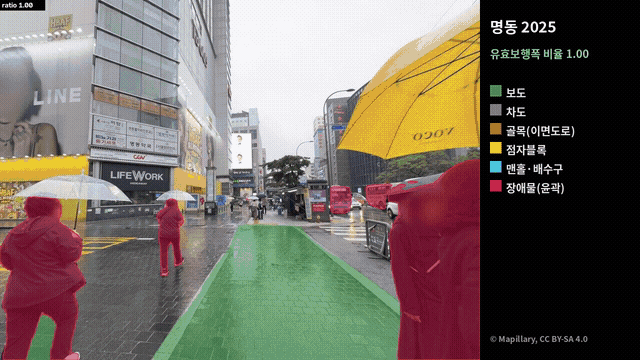
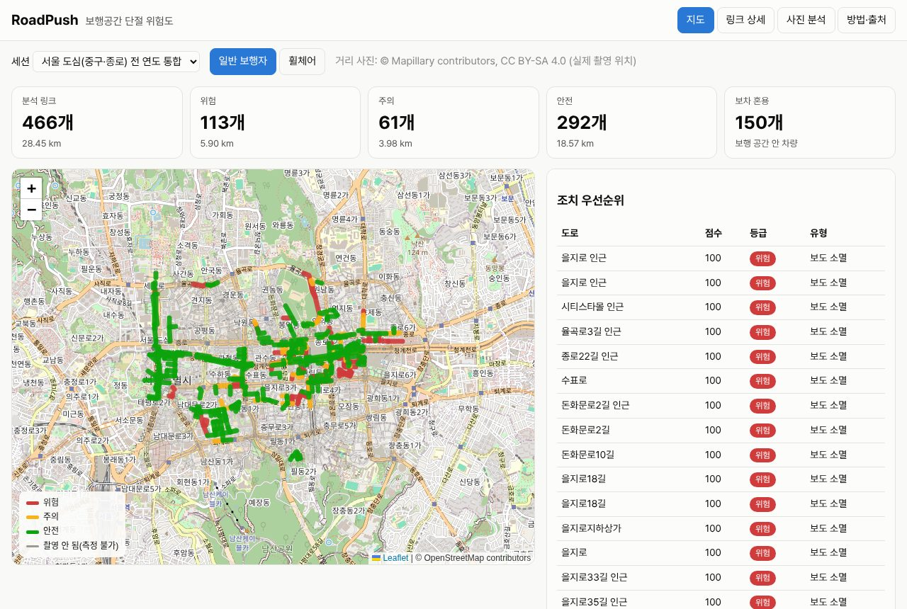
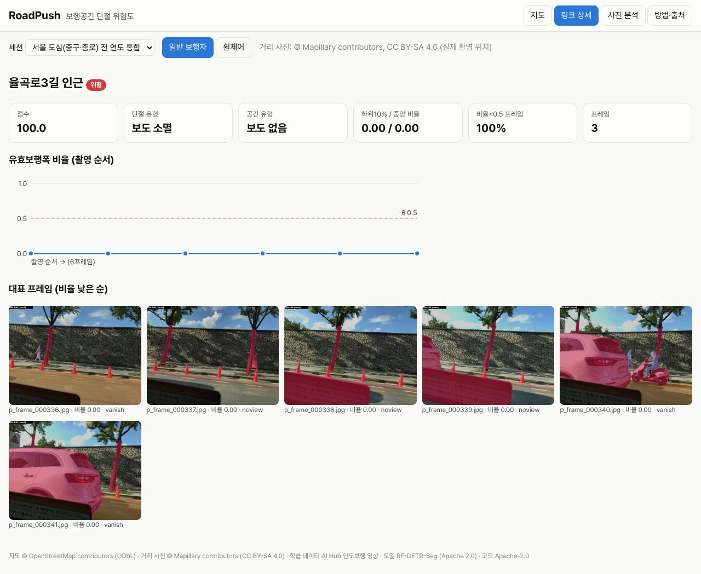
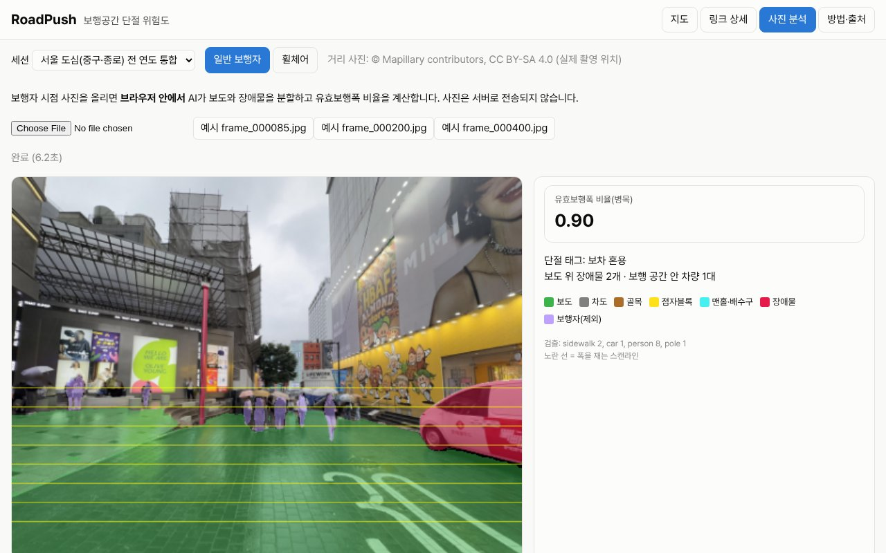
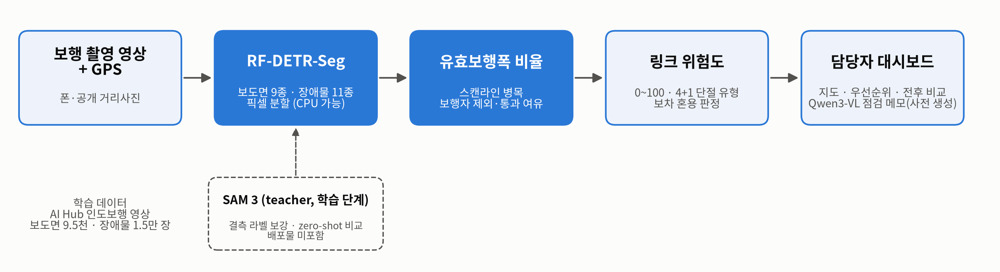
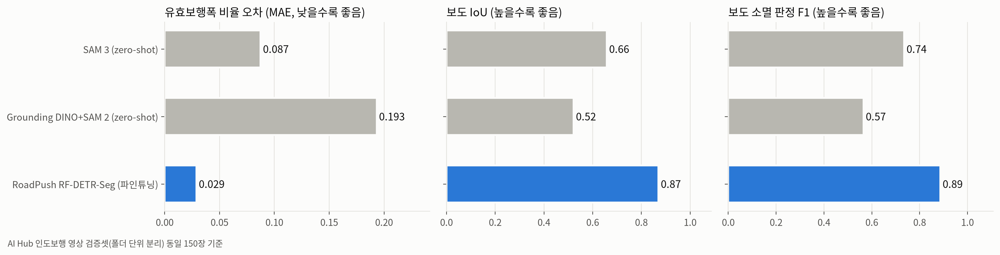
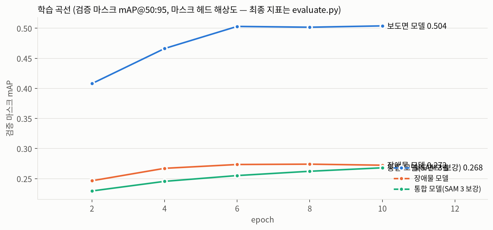
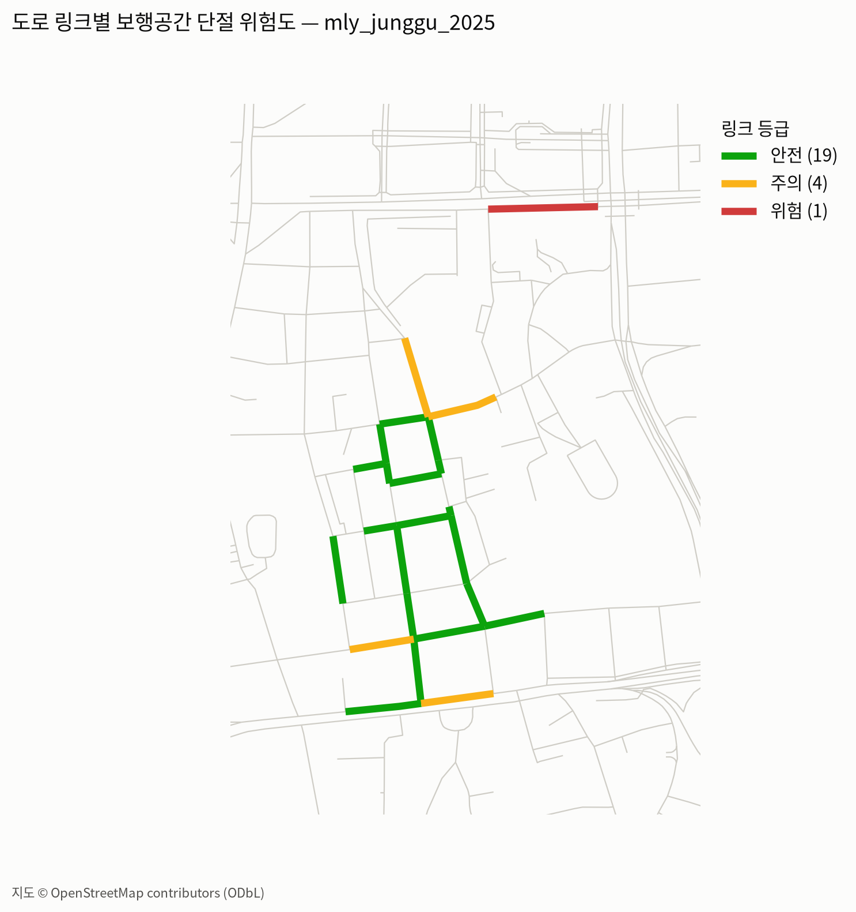
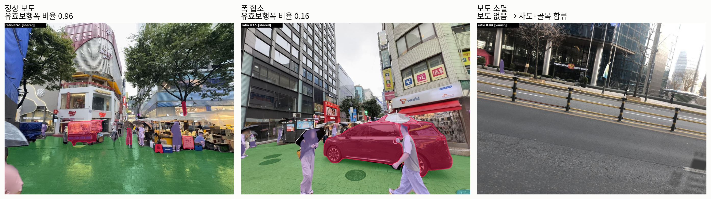

# RoadPush — 보행공간 단절 위험도 자동 산출

**걷는 사람이 차도로 밀려나는(push) 구간을, 거리 사진만으로 찾아 도로 구간(링크)마다 점수로 보여 주는 AI.**
2026 AI 라이프 솔루션 챌린지(산업통상부·KEIT) 출품작 · 아이디어 챌린지 후보작 *RoadPush* 구현.

- 1차 사용자: 지자체·도로관리기관 보도 담당자 — 어디부터 단속·정비할지 우선순위
- 대상 지역: 서울 도심(중구·종로) **466개 링크 · 28.4 km** — 공개 거리 사진(Mapillary, CC BY-SA) 7,559장(360° 변환 포함)의 실제 촬영 위치
- **웹앱(테스트 URL)**: https://huggingface.co/spaces/YunSangNam/roadpush — 서버 없는 정적 웹앱, 사진 분석은 브라우저 안에서 실행 *(제출 전까지 비공개)*

진행 기록 [PROGRESS.md](PROGRESS.md) · 결과 수치 [docs/results.md](docs/results.md) · 계획 [PLAN.md](PLAN.md)

---

## 한눈에 보기

**명동 실사진 분석** — 보도(초록)·차도(회색)·골목(갈색)·장애물(빨강)·보행자(연보라, 장애물로 세지 않음), 오른쪽에 유효보행폭 비율



**웹앱 — 지도**: 링크마다 위험/주의/안전, 회색은 사진이 없어 측정하지 못한 길. 오른쪽은 조치 우선순위



**웹앱 — 링크 상세**: 점수·단절 유형, 멀티모달 LLM 점검 메모(원인·권고), 촬영 순서별 비율, 대표 프레임



**웹앱 — 사진 분석**: 사진을 올리면 AI가 브라우저 안에서 분할·계산(사진은 밖으로 나가지 않음)



> 그림은 학습·분석이 진행되면 자동으로 다시 그려져 약 90분마다 푸시된다(`scripts/autopush.sh`).

---

## 어떻게 동작하나



1. **분할** — RF-DETR-Seg(Apache 2.0) 두 개가 보도면 9종(보도·점자블록·차도·골목·자전거도로·계단·공사·맨홀·가로수틀)과 장애물 11종(차량·이륜차·볼라드·입간판·노점 등)을 픽셀 단위로 나눈다.
2. **유효보행폭 비율** — 화면 하단 가로줄마다 "실제로 지나갈 수 있는 폭 ÷ 원래 보도 폭"을 재고 가장 좁은 곳(병목)을 프레임 값으로. 원근 때문에 m 대신 비율(제안자 답변). 보행자는 조치 대상이 아니라 제외.
3. **링크 위험도** — GPS로 OpenStreetMap 보행 링크에 붙여 0~100점·등급, 단절 유형(보도 소멸·폭 협소·공사·단차·**보차 혼용**), 휠체어 기준(폭 0.7·단차 가중).
4. **점검 메모** — Qwen3-VL-8B가 측정값과 대표 프레임을 근거로 원인·권고를 작성. 닫힌 질문으로 분할 결과와 교차검증한 사실만 사용(VLM 단독은 환각률이 높음).

## 결과 (AI Hub 검증셋, 촬영 폴더 단위 분리)

| | SAM 3 (zero-shot) | Grounding DINO + SAM 2 | **RoadPush (파인튜닝)** |
|---|---|---|---|
| 유효보행폭 비율 오차 (같은 150장) | 0.109 | 0.200 | **0.038** |
| 장애물 mIoU (같은 150장·9종) | 0.518 | 0.373 | **0.701** |
| 비율 오차 · 보도 소멸 F1 (전체 954장) | – | – | **0.017** · **0.915** |
| 장애물 mIoU (전체 1,566장) | – | – | **0.736** |




 

## 코드

| 모듈 | 역할 |
|---|---|
| `classes.py` | 20개 클래스, AI Hub 라벨 매핑, 통행 가능면·이동 객체·차량 구분 |
| `convert_aihub_to_coco.py` · `merge_coco.py` | AI Hub XML → COCO(폴더 단위 분할, 희소 클래스 선택), 데이터 병합·SAM 3 결측 보강 |
| `train.py` · `infer.py` · `evaluate.py` | RF-DETR-Seg 학습 / 다중 모델 추론 / IoU·비율 MAE·소멸 F1 |
| `width_ratio.py` · `scoring.py` | 유효보행폭 비율(병목), 링크 점수·단절 유형·공간 유형·휠체어 프로필 |
| `mapillary.py` · `links.py` · `aggregate.py` · `merge_runs.py` | 공개 보행 사진 수집(360° 시점 변환 포함), OSM 링크·스냅, 링크 집계 |
| `vlm.py` · `sam3_label.py` · `gdino_label.py` | 멀티모달 LLM 확인·메모·환각 측정, zero-shot teacher |
| `web/` · `scripts/build_static.py` | 정적 웹앱(Leaflet + onnxruntime-web) |
| `scripts/` | 다운로드·대기열·그림·성과보고서 PPT 자동 생성(`build_report.py`) |

```bash
E="env -u PYTHONPATH"                       # 외부 PYTHONPATH(ROS 등) 차단
bash scripts/setup_env.sh                   # conda env: roadpush, sam3
bash scripts/aihub_fetch.sh                 # AI Hub 인도보행 영상 (.aihub_key)
$E python -m roadpush.convert_aihub_to_coco --xml-dir data/raw/aihub/extracted/surface \
   --img-root data/raw/aihub/extracted/surface --out data/coco/surface_v1
$E python -m roadpush.train --dataset data/coco/surface_v1 --run seg_m_surface_v1          # tmux 안에서
$E python -m roadpush.mapillary --area downtown --out outputs/mly_downtown_all             # .mapillary_token
bash scripts/redeploy_static.sh             # ONNX 내보내기 → 정적 사이트 → HF Space
$E pytest                                   # 39 tests
```

## 출처·라이선스
코드 Apache-2.0. 학습 데이터 AI Hub 인도보행 영상(한국지능정보사회진흥원, 이용약관 범위). 거리 사진 © Mapillary contributors (CC BY-SA 4.0, 얼굴·번호판 자동 블러).
지도·링크 © OpenStreetMap contributors (ODbL). SAM 3는 라벨링 teacher로만 사용하며 배포물에 포함하지 않음.
